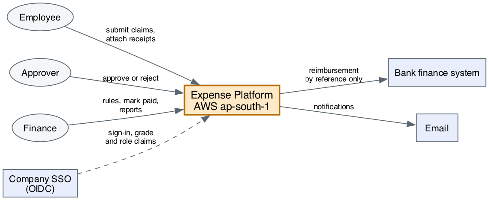
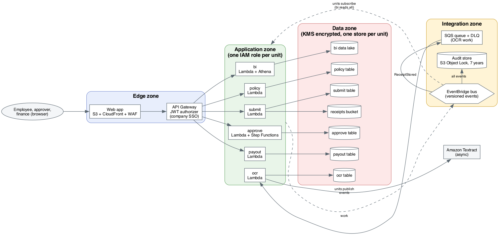
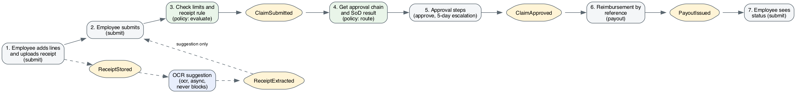

# High-level design

Keeps to the approved scope: six units, events between them, own data per unit ([units](../inception/units/README.md), [interfaces](../inception/units/interfaces.md)). Platform choices are in [ADR-008](../decisions/adr-008-serverless-platform.md). Per-unit detail comes in the LLDs.

> **AI proposes, humans decide.** This HLD is a draft by Claude. The Architect and Engineer review it, and each unit's LLD needs its own approval before any code ([approvals](../approvals/)).

## 1. Context

*Source: [context.dot](diagrams/context.dot), vector: [context.svg](diagrams/context.svg). Redraw with `dot -Tpng context.dot -o context.png`.*

| Actor or system | Interaction |
| --- | --- |
| Employee | Creates and submits claims with receipts, sees status |
| Approver | Reviews claim and receipt, approves or rejects |
| Finance | Maintains policy rules, marks claims paid, reads reports |
| Company SSO | OIDC sign-in and group claims (grade, role). Assumption Q37 |
| Bank finance system | Pays the employee. Platform sends a reference only (Q34) |

## 2. Architecture

*Source: [architecture.dot](diagrams/architecture.dot), vector: [architecture.svg](diagrams/architecture.svg). Redraw with `dot -Tpng architecture.dot -o architecture.png`.*

### Decisions at this level

| Area | Choice | Why |
| --- | --- | --- |
| Compute | Lambda per unit, Step Functions for approval chain and timers | Small bolts, no servers, timers for escalation |
| Data | DynamoDB per unit, S3 for receipts, S3 and Athena for `bi` | No shared tables. Each unit's role can reach only its own store |
| Integration | EventBridge bus, SQS with a dead-letter queue for OCR | Past-tense versioned events ([ADR-006](../decisions/adr-006-versioned-events.md)) |
| API | API Gateway REST, versioned `/v1`, JWT from company SSO | One front door, rules for throttling and auth |
| IaC | AWS CDK (TypeScript) | Already installed. Reviewed like code in DEP-01 |
| Region | `ap-south-1` only | NFR B1, Q24 |

## 3. Key flow

*Source: [key-flow.dot](diagrams/key-flow.dot), vector: [key-flow.svg](diagrams/key-flow.svg). Redraw with `dot -Tpng key-flow.dot -o key-flow.png`.*

## 4. Security zones and controls

| Zone | Contains | Controls |
| --- | --- | --- |
| Edge | CloudFront, WAF, API Gateway | TLS 1.2 or higher, WAF rules, rate limits, JWT checked at the gateway |
| Application | Lambda, Step Functions | One IAM role per unit, least privilege, no wildcard access to another unit's store |
| Data | DynamoDB, S3, data lake | KMS customer-managed keys, encrypt at rest, S3 block public access, receipt access limited to submitter, approvers and finance (Q14) |
| Integration | EventBridge, SQS, audit store | Event payloads hold ids not personal data, audit store with S3 Object Lock for immutability |

Cross-cutting:

- **Identity:** SSO groups give grade and role. Approvers see a claim only while assigned.
- **Segregation of duties:** enforced in `policy` and `approve` logic ([ADR-002](../decisions/adr-002-sod-in-the-model.md)), never only in the UI.
- **Secrets:** AWS Secrets Manager. Nothing in git, nothing in env files for deployed systems.
- **Region guardrail:** a service control policy denies other regions.
- **Malware scan:** every upload is scanned before it is readable.

## 5. NFR mapping

Every row of the [NFR matrix](../inception/nfr-matrix.md) maps to a design element or is flagged.

| NFR | Design element | Status |
| --- | --- | --- |
| Audit, 100% of state changes | Every unit emits events. A rule on the bus writes all events to the audit store (Object Lock, 7 years) | Covered |
| PII not in logs | Structured logger that accepts ids only. Log scan in BLD-02 | Covered |
| SoD | `policy` route and `approve` checks, SOD-1 to SOD-4 | Covered |
| Latency p95 under 300 and 500 ms | Lambda with DynamoDB key reads, no cross-unit joins | Covered, verify by load test |
| Upload 10 MB in 10 s | Presigned S3 upload straight from the browser | Covered |
| Availability 99.9% | Managed multi-AZ services, no single server | Covered |
| RPO 1 h, RTO 4 h | DynamoDB point-in-time recovery, S3 versioning, IaC redeploy | Covered, DR test |
| OCR accuracy 95% | Textract plus a sample test pack | Covered, test pack needed |
| Encryption | KMS and TLS everywhere | Covered |
| Residency | One region plus guardrail | Covered |
| Retention | Scheduled expiry job in `submit` and `ocr` | Covered |
| Malware | Scan step before the receipt is marked stored | Tool not chosen, LLD of `submit` |
| Capacity 5,000 claims a day, 10x | Serverless scaling, OCR queue and async Textract (R3) | Covered, quota check |
| Cost | Pay-per-use services | Flagged: no target yet (Q35) |

## 6. Environments and delivery

| Item | Design |
| --- | --- |
| Accounts | Separate dev, test and prod AWS accounts (Q38) |
| Pipeline | CDK pipeline built in DEP-01. Prod deploy needs a named human approver |
| Config | Policy rules are data ([ADR-001](../decisions/adr-001-rules-as-versioned-yaml.md)), changed without a release |
| Build order | `policy` then `submit`, then `approve`, `payout`, `ocr`, `bi` |

## 7. Observability

- Structured JSON logs with a correlation id (the claim reference). No PII.
- Metrics and alarms per unit: error rate, latency p95, queue depth, DLQ count.
- Tracing with AWS X-Ray across API calls. Events carry the correlation id.
- Alarms feed the alert hook in DEP-02.

## 8. Risks and open points

| # | Item | Where tracked |
| --- | --- | --- |
| 1 | Company SSO type and group claims not confirmed | Q37 |
| 2 | Three AWS accounts assumed | Q38 |
| 3 | No cost target | Q35 |
| 4 | OCR request limit at peak | R3, [ADR-007](../decisions/adr-007-async-ocr.md) |
| 5 | Malware scan tool not chosen | LLD of `submit` |
| 6 | HEIC to JPEG conversion for OCR | Q30 |
| 7 | Mock policy values still in rules | Q18, R2 |

## 9. Review checklist (for the Architect and Engineer)

- [ ] Every unit appears with its own store and no shared tables.
- [ ] Every event in [interfaces.md](../inception/units/interfaces.md) has a producer in this design.
- [ ] Every NFR row is covered or has an owner for the flag.
- [ ] Each choice has a reason, and big ones have an ADR.
- [ ] Diagrams match the text. Diagram source is in `diagrams/` as Graphviz `.dot` files, with the PNG and SVG next to them.
- [ ] Open points are logged in the [question log](../inception/question-log.md).

## 10. What comes next

1. Review this HLD (Architect and Engineer).
2. LLD for `policy`, then `submit`: spec, APIs, events, data model, sequences, plan of bolts.
3. Engineering review of each LLD, then the Architect records `aidlc-docs/approvals/lld-<unit>.md`.
