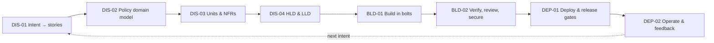

# AI-DLC Playbook Overview — Expense Management Platform

> **AI-DLC in one line:** AI plans, proposes and builds; humans set intent, decide at every gate and own the outcome — delivered in bolts of hours or days, with all context kept in the repo.

## Phases

| # | Phase | Focus | Mode | Key output |
| --- | --- | --- | --- | --- |
| 1 | Discover | What & why | Mob Elaboration | Approved HLD, LLD, policy rules, approval matrix, NFRs & security checks |
| 2 | Build | How | Mob Construction | Tested service, shippable build, infra, CI & CD pipeline |
| 3 | Deploy & Monitor | Run & learn | Human-gated release | Reimbursement tracking, spend dashboard |



## Activity index (slide 2)

| ID | Activity | Actor | Hook | Human gate (exit) |
| --- | --- | --- | --- | --- |
| [DIS-01](1-discover/dis-01-intent-to-stories.md) | Intent → stories (Mob Elaboration) | Solution Owner · BA | `UserPromptSubmit` | PRD + stories sign-off |
| [DIS-02](1-discover/dis-02-policy-approval-domain-model.md) | Policy & approval rules as a domain model | Solution Owner + Architect | `PreToolUse` | Spec sign-off |
| [DIS-03](1-discover/dis-03-units-of-work-and-nfrs.md) | Units of work & NFRs | Architect | `PreToolUse` (approval gate) | Units + NFRs approval |
| [DIS-04](1-discover/dis-04-hld-lld-design-approval.md) | HLD & LLD per unit + design approval | Architect + Engineer | `PreToolUse` | LLD approval per unit |
| [BLD-01](2-build/bld-01-build-units-in-bolts.md) | Build each unit in bolts | Engineer · FED | `PostToolUse` | Bolt accepted |
| [BLD-02](2-build/bld-02-verify-review-secure.md) | Verify, review & secure | Engineer + Test | `PreToolUse` | PR approved + UAT signed |
| [DEP-01](3-deploy-monitor/dep-01-deploy-iac-release-gates.md) | Deploy with IaC & release gates | Engineer + Architect | `PreToolUse` | Prod release approved |
| [DEP-02](3-deploy-monitor/dep-02-operate-analytics-feedback.md) | Operate, spend analytics & feedback loop | Solution Owner + Engineer | `Notification` | Next intent approved |

All hooks in one place: [hooks-catalog.md](hooks-catalog.md).

## Roles

| Role | Owns |
| --- | --- |
| Solution Owner | Business intent, expense policy and approval rules; signs off stories and releases |
| Architect | Splits work into units; sets NFRs (audit, PII, SoD); approves designs; owns hooks |
| Engineer | Drives agents each bolt — spec, code, tests, IaC — and reviews every AI change |
| BA (on demand) | Finance policy and edge cases |
| FED (on demand) | Approver UX and dashboards |
| Test (on demand) | UAT and compliance packs |

## Approval records (how gates work)

Hooks read approval files in `aidlc-docs/approvals/`. A gate is open only when the file contains `Status: APPROVED`.

```markdown
# Approval: <gate name>

Status: APPROVED
Approved-by: <name, role>
Date: YYYY-MM-DD
Scope: <unit / release / document>
Evidence: <link to PR, Confluence page or Jira>
Conditions: <none, or list>
```

| Gate file | Set in | Unlocks |
| --- | --- | --- |
| `prd-signoff.md` | DIS-01 | DIS-02 |
| `spec-signoff.md` | DIS-02 | Any write to `src/` or `infra/` (still per-unit gated below) |
| `units-nfr.md` | DIS-03 | Writes to `aidlc-docs/design/` |
| `lld-<unit>.md` | DIS-04 | Writes to `src/<unit>/` |

Only the named approver edits an approval file. Changes to approval files and `.claude/hooks/` go through PR review by the Architect (see `CODEOWNERS` suggestion in the README).

## Artifact layout

```text
aidlc-docs/
  glossary/        policy-glossary.md
  inception/       intent, prd, stories, domain model, rules schema, units/, nfr-matrix
  decisions/       adr-NNN-*.md
  design/          hld.md, <unit>/ spec, lld, plan, api/, review
  construction/    bolt-log.md, <unit>/ reviews, qa-report, uat-pack, risk-log.md
  operations/      releases, runbook, incidents/, insights/, retros/, next-intent.md
  approvals/       gate files listed above
src/<unit>/        code per unit
tests/<unit>/      tests per unit; tests/e2e/ Playwright
infra/             AWS CDK, pipeline, observability
```

## Legend

| Prefix | Meaning |
| --- | --- |
| MP | Matt Pocock skills |
| AO | Addy Osmani agent-skills |
| GS | gstack (Garry Tan) |
| Hooks | Claude Code hook events |
| Bolt | Smallest unit of work that can be delivered; replaces the sprint |
| Mob | Mob programming — the whole team works on one granular task at the same time |

## Change log

| Version | Date | Author | Change |
| --- | --- | --- | --- |
| 1.0.0 | 2026-10-29 | AI-DLC team | First version from slides 1–2 |
